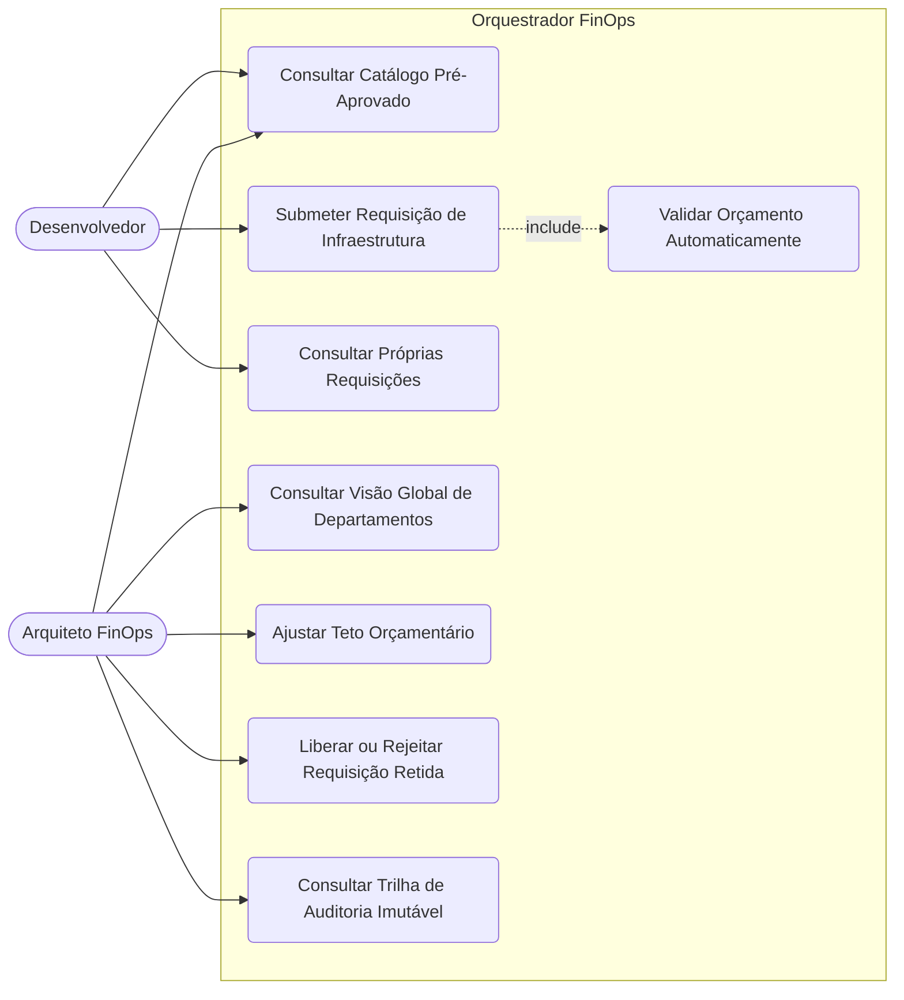
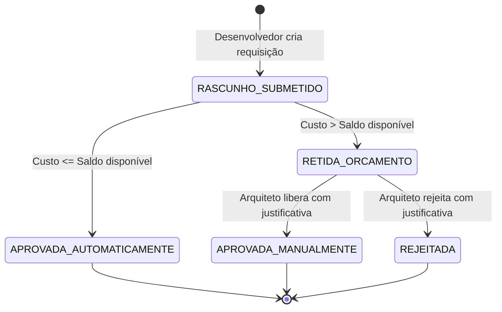
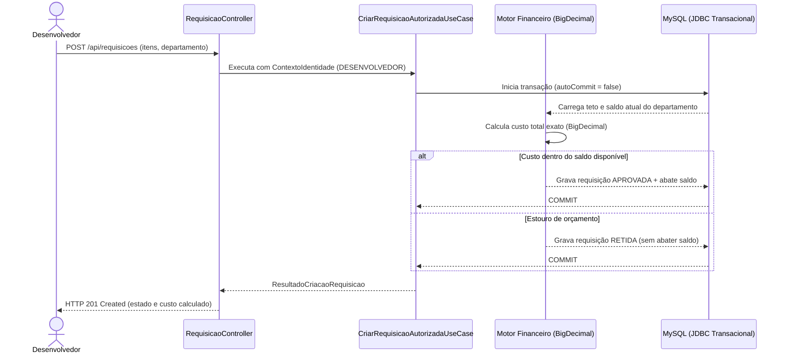

# Diagramas Comportamentais e de Casos de Uso (Texto Versionado)

Artefatos de modelagem versionados em texto (sintaxe **Mermaid**) complementando os diagramas visuais em `docs/uml/` (`dominio-v1.png`, `RF-02-estados.png` e `RF-02-sequencia.png`), conforme diretriz de rastreabilidade do projeto.

## 1. Diagrama de Casos de Uso por Perfil (`SPEC-006`)

## 2. Máquina de Estados da Requisição (`EstadoRequisicao`)

## 3. Sequência de Submissão e Validação Transacional (`SPEC-002` / `SPEC-003`)

